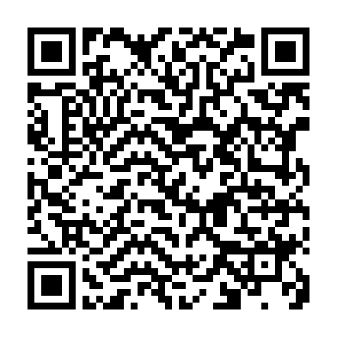
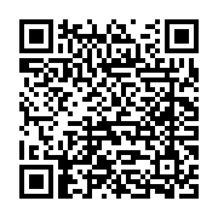

# 🌙 Midnight Token Claim Tools for Trezor Users

**Extract private keys from Trezor wallets to claim Midnight (NIGHT) tokens**

This repository provides tools to help Trezor users claim Midnight tokens from both **Cardano addresses** and **Bitcoin addresses**. The official Midnight Portal has known issues with hardware wallet integration, making these tools necessary for successful claiming.

## ⚠️ CRITICAL SECURITY WARNING

- **These tools require exposing your hardware wallet seed phrase and passphrase**
- **NEVER use these tools on your primary wallet with funds**
- **ALWAYS create a NEW wallet first and transfer funds there**
- **Only use your OLD eligible addresses for claiming authorization**
- **Delete all generated private keys immediately after claiming**
- **Use only on secure, isolated computers**

## 🎯 Choose Your Claim Type

### 🔗 Cardano Address Claims
**For users with eligible ADA addresses**

If your Midnight token eligibility is tied to a Cardano address (starts with `addr1`):

**👉 [Go to Cardano Claim Guide](cardano-claim/README_CARDANO.md)**

**What you'll need:**
- Synced Cardano node
- Eternl wallet browser extension
- Stake key information from your Cardano wallet

**Process:**
- Generate Cardano `.skey` files
- Convert to CLI format
- Import to Eternl wallet
- Execute claim through Midnight Portal

---

### ₿ Bitcoin Address Claims
**For users with eligible Bitcoin addresses**

If your Midnight token eligibility is tied to a Bitcoin address (starts with `1`, `3`, or `bc1`):

**👉 [Go to Bitcoin Claim Guide](bitcoin-claim/README_BITCOIN.md)**

**What you'll need:**
- Software Bitcoin wallet (Electrum, Sparrow, etc.)
- No blockchain node required

**Process:**
- Generate Bitcoin WIF private keys
- Import to software wallet
- Execute claim through Midnight Portal

## 🔒 Universal Security Strategy

**Both claim methods use the same critical security approach:**

### Before Starting ANY Claim:
1. **Create a NEW Trezor wallet** with fresh seed phrase
2. **Transfer ALL funds** from your old wallet to the new wallet
3. **Keep your OLD wallet** for claiming authorization only
4. **Never mix the two wallets**

### During Claiming:
- **OLD wallet** = Proves eligibility (becomes compromised when seed exposed)
- **NEW wallet** = Receives claimed tokens (stays secure)
- **Never use OLD wallet addresses for receiving anything**

### After Claiming:
- **Immediately delete** all private key files
- **Transfer claimed tokens** to your NEW secure wallet
- **Abandon the OLD wallet completely**
- **Clear all traces** from your computer

## 📋 General Requirements

### Hardware Requirements
- **Trezor Model T or Trezor One**
- **Your Trezor seed phrase** (12 or 24 words)
- **Passphrase** (if you use one)

### Software Requirements
- **Python 3.8+** with pip
- **Secure computer** (preferably offline during key generation)
- **Browser** for Midnight Portal access

### Information You'll Need
- **Eligible address** (Cardano or Bitcoin)
- **Your Trezor seed phrase and passphrase**
- **Derivation information** (varies by claim type)

## 🚨 Why These Tools Are Necessary

### Portal Hardware Wallet Issues
The official Midnight Portal has documented problems with:
- Trezor passphrase-protected wallets
- Proper derivation path detection
- Hardware wallet connection stability
- Cross-browser compatibility

### Our Solution
These tools bypass portal issues by:
- Extracting private keys directly from Trezor seeds
- Testing multiple derivation scenarios automatically
- Supporting both passphrase-protected and standard wallets
- Providing reliable key formats for software wallet import

## 🛠️ Repository Structure

```
/
├── README.md (this file)
├── cardano-claim/
│   ├── README_CARDANO.md
│   ├── midnight_claim_cardano.py
│   ├── cli_convert.py
│   ├── requirements_cardano.txt
│   └── .env.example_cardano
├── bitcoin-claim/
│   ├── README_BITCOIN.md
│   ├── midnight_claim_bitcoin.py
│   ├── requirements_bitcoin.txt
│   └── .env.example_bitcoin
└── docs/
    ├── SECURITY_GUIDE.md
    ├── TROUBLESHOOTING.md
    └── FAQ.md
```

## ⚡ Quick Start Guide

1. **Determine your claim type** (Cardano or Bitcoin address)
2. **Create NEW wallet** and transfer funds there first
3. **Follow the specific guide** for your claim type
4. **Extract private keys** using the appropriate tool
5. **Import to software wallet** and execute claim
6. **Immediately delete** all private key files
7. **Transfer claimed tokens** to your NEW secure wallet

## ✅ Tested Configurations

### Successfully Tested:
- **Trezor Model T** with passphrase protection
- **Trezor One** with and without passphrase
- **12-word and 24-word seed phrases**
- **Windows 11** and **Linux** environments
- **Multiple Bitcoin address types** (Legacy, SegWit, Native SegWit)
- **Cardano mainnet addresses** with staking keys

### Confirmed Working Wallets:
- **Cardano**: Eternl, Typhon, Nami
- **Bitcoin**: Electrum, Sparrow, Bitcoin Core

## 🔍 FAQ

### Q: Which claim type do I need?
**A:** Check your Midnight Portal eligibility. If it shows a Cardano address (`addr1...`), use the Cardano guide. If it shows a Bitcoin address (`1...`, `3...`, or `bc1...`), use the Bitcoin guide.

### Q: Can I use both tools?
**A:** Only if you have eligibility on both blockchains. Most users have eligibility on only one chain.

### Q: Is this safe?
**A:** When following the security strategy (NEW wallet for funds, OLD wallet for claiming), yes. The key is never mixing the two wallets.

### Q: Do I need technical knowledge?
**A:** Basic command-line usage is required. The guides provide step-by-step instructions for all technical steps.

### Q: What if something goes wrong?
**A:** If you follow the security strategy, your funds remain safe in your NEW wallet. You can retry the claiming process or contact Midnight support for alternatives.

## 🆘 Support

### Technical Issues
- **Script problems**: Create GitHub issue with detailed error information
- **General guidance**: Check the FAQ and troubleshooting documents

### Midnight Claims
- **Portal issues**: Contact Midnight support team
- **Eligibility questions**: Midnight Portal help section

### Wallet Support
- **Eternl problems**: Visit Eternl documentation
- **Bitcoin wallet issues**: Consult specific wallet documentation

## ⚖️ Important Disclaimers

- **These tools are provided as-is without warranty**
- **Authors are not responsible for lost funds or failed claims**
- **Always verify all outputs independently**
- **Use only for legitimate Midnight token claims**
- **This method exposes seed phrases - follow security strategy strictly**
- **Test with small amounts first when possible**

## 👍 Support This Project

If these tools helped you successfully claim your Midnight tokens:

### QR Codes for Easy Donations:

**Bitcoin**: `bc1qkj9f592hlj3m26eukc54xruls6pdzqs70ly8a5`



**Cardano**: `addr1qxk3cq8emwuusdlas04yn0qf3xndd6ts6ta7l3kh4vphuhss0y3k3y7r4ztz6xy0xjysj4j9ksysnlhnp0stqdwwyusq9g5th3`



Tips help maintain and improve these tools for the community.

---

## 🚀 Ready to Claim?

**Choose your path:**

- **🔗 [Cardano Address Claims →](cardano-claim/README_CARDANO.md)**
- **₿ [Bitcoin Address Claims →](bitcoin-claim/README_BITCOIN.md)**

**Remember: Security first - create new wallet, use old address for claiming, delete everything after claiming!**